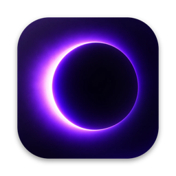
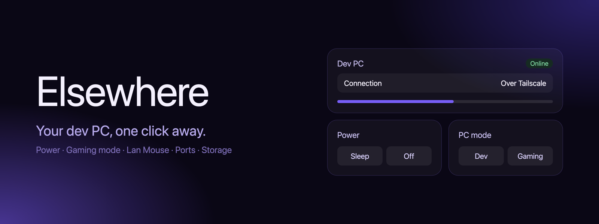

<p align="center">
  
</p>

<p align="center">
  
</p>

<p align="center">
  <a href="https://github.com/Eliezir/elsewhere/releases/latest">Download</a> ·
  <a href="https://eliezir.github.io/elsewhere/">Website</a> ·
  <a href="https://github.com/Eliezir/elsewhere/releases">Releases</a>
</p>

# Elsewhere

**Your dev PC, one click away.** Elsewhere is a desktop app that connects your Mac to the machine you build on, usually a PC or a VM on your [Tailscale](https://tailscale.com) network. It shows whether the machine is online, wakes it, puts it to sleep or shuts it down, switches it between dev and gaming mode, lends it your keyboard and mouse, and forwards dev-server ports in the background. Everything goes over the SSH connection you already have. There are no servers of ours, no account and no analytics.

<p align="center">
  <a href="https://github.com/Eliezir/elsewhere/releases/latest"></a>
  
  
</p>

## Features

**Connection**
- Live status of the machine: online or offline, CPU, disk and load, refreshed every few seconds.
- A menu bar popover with health, power and quick actions, so you rarely need to open the window.
- Tailscale state, SSH approval prompts and reconnecting without leaving the app. The menu bar icon shows a dot when Tailscale SSH needs your approval and a ring when the machine is unreachable.

**Power**
- **Wake** sends a Wake-on-LAN packet when the machine is asleep or off. It needs the machine's MAC address in Settings and Wake-on-LAN enabled on the PC.
- **Sleep**, **Shut down** and **Restart** run over SSH. Each one is a **press and hold**, so a stray click never ends a session.
- Optional **shut down or sleep when idle**: a watcher on the machine that does nothing while a build, agent or dev server is busy.

**Gaming mode**
- Stops the development environment on the PC so it is free for games, and returns to dev mode on its own the next time the PC starts.
- Hold to start. It declines to switch while something is still running.

**Lan Mouse** (macOS)
- Open and close [Lan Mouse](https://github.com/feschber/lan-mouse) on the PC and on your Mac from the app or the menu bar, borrow the keyboard and mouse for 15 minutes, and release them with a shortcut. Setup is guided, including the fingerprint authorization.

**Notifications**
- Native notifications when the machine goes offline, comes back, a disk is nearly full, or a port can't be forwarded. Each can be switched off in Settings.

**Ports, in the background**
- Every dev server on the machine is found, grouped by project and branch and forwarded to your Mac without any setup.
- If a port is already used on your Mac, Elsewhere picks a free one and shows the link to use. Pin a port to keep a number for a project.

**Worktrees and storage**
- Send a worktree to the machine with its branch, unsaved changes (committed as a WIP commit) and Claude sessions, with paths rewritten, and bring it back. Sync only fast-forwards and never guesses when both sides changed.
- Worktrees on both machines, labelled by origin (Conductor, T3 Code, Claude agent or manual), with stale and merged ones flagged.
- A Storage tab for what each machine spends on projects and caches, and a delete that asks which copy and needs a press and hold when changes would be lost.

**More than one machine**
- Add a second host, such as a VM, and choose the primary one. Each host can be switched on or off in Settings.

## Install

**macOS:** download the latest `.dmg` from the [releases page](https://github.com/Eliezir/elsewhere/releases). The build is not signed yet, so on first launch right-click the app and choose Open (or run `xattr -dr com.apple.quarantine /Applications/Elsewhere.app`).

**Windows (preview):** download the `.exe` installer from the same page. It is unsigned, so SmartScreen shows a warning: choose More info, then Run anyway. Connection health, ports and forwarding, storage and Tailscale are the parts built for Windows. Lan Mouse control, send and bring back, and the Conductor and T3 Code shortcuts are macOS only for now. It needs the OpenSSH client, included with Windows 10 and 11.

## Quick start

1. Put your Mac and the PC on the same Tailscale network and make sure `ssh <user>@<host>` works. Tailscale SSH may ask you to approve the first connection in a browser, and Elsewhere shows an **Approve** button when it does.
2. Open Settings in Elsewhere and enter the machine's Tailscale host name and user.
3. To use **Wake**, add the machine's MAC address in Settings and enable Wake-on-LAN on the PC. The steps for Windows with WSL are in [`docs/wol`](docs/wol).

## How it works

- **Connection.** A background loop checks the machine over SSH every few seconds, so the power and mode buttons always match its real state.
- **Power.** Wake is a Wake-on-LAN magic packet to the local broadcast address. Sleep, shut down and restart run detached on the machine, so they still finish after the SSH session they started from ends.
- **Ports.** Elsewhere lists listeners with `ss` over SSH, finds the folder and git branch each one runs from, and opens one `ssh -L` tunnel per project port from the same loop.
- **Moves.** Each project gets a bare hub repository on the machine. The branch is pushed to a private ref, a worktree is created from it, and Claude session folders are copied with the path inside them rewritten. Bringing work back is fast-forward only.

## Claude Code mods

The `mods/` folder holds mods for Claude Code and the Code tab of Claude Desktop. `workbench` adds a Ports pane (`/ports`) for the folder a session runs in, with Kill, and puts the branch and ports in the status line.

```text
/plugin install workbench --marketplace Eliezir/elsewhere
```

In Claude Desktop, where `/plugin` does not run: click + next to the prompt box, then Plugins, Add marketplace with `Eliezir/elsewhere`, then Add plugin.

## Troubleshooting

- **Elsewhere says the machine is unreachable.** Check Tailscale is connected and that `ssh <user>@<host> echo ok` prints `ok` without a prompt.
- **Wake does nothing.** The MAC address must be set in Settings, the Mac and PC must be on the same network, and Wake-on-LAN must be enabled in the PC's BIOS and network adapter. See [`docs/wol`](docs/wol).
- **Tailscale keeps asking for SSH approval.** Elsewhere shows a dot on its menu bar icon and an **Approve SSH access** button. To stop the prompts, open your tailnet's access rules and set **Check mode** to **Off** for the SSH rule (`"action": "accept"`), or raise `checkPeriod` up to `168h`.
- **`localhost:5173` opens a different project.** Something else on your Mac holds that port. Use the link on the port's row, or pin a port.
- **Remote Control, phone apps and similar features** depend on your Claude plan. Elsewhere does not need them.

## Layout

- `apps/desktop`: Electron app (electron-vite, React, Tailwind v4, Base UI, Motion, TanStack Query)
- `apps/daemon`: legacy Node service for a VM, no longer used by the app
- `packages/shared`: Zod schemas and the IPC contract shared by both

## Commands

```bash
pnpm install
pnpm dev          # Electron app in dev mode
pnpm build
pnpm typecheck
pnpm test
pnpm lint
pnpm --filter @vmc/desktop package       # macOS .dmg and .zip in apps/desktop/release
pnpm --filter @vmc/desktop package:win   # Windows installer (run on Windows)
```

Render the popover to a PNG without clicking the tray:

```bash
pnpm --filter @vmc/desktop build
cd apps/desktop && VMC_DEBUG_SCREENSHOT=/tmp/popover.png pnpm exec electron .
```

## Releases

Push a tag such as `v0.1.0` and the Release workflow builds the macOS and Windows apps and attaches the `.dmg`, `.zip` and `.exe` files to a GitHub release.

## License

MIT
