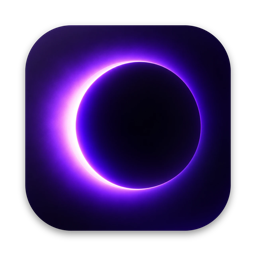
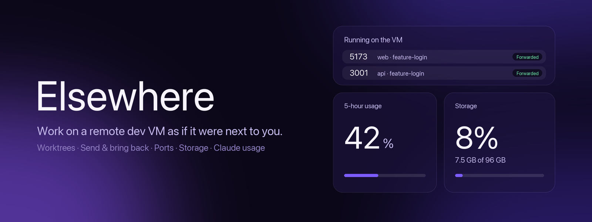

<p align="center">
  
</p>

<p align="center">
  
</p>

<p align="center">
  <a href="https://github.com/Eliezir/elsewhere/releases/latest">Download</a> ·
  <a href="https://eliezir.github.io/elsewhere/">Website</a> ·
  <a href="https://github.com/Eliezir/elsewhere/releases">Releases</a>
</p>

# Elsewhere

**Work on a remote dev VM as if it were next to you.** Elsewhere is a desktop app that sits between your Mac and a VM you reach over Tailscale. It moves work back and forth, forwards the dev servers it finds, keeps agents running when your laptop closes, and shows what the VM is doing, all through the SSH connection you already have. There are no servers of ours, no account and no analytics.

<p align="center">
  <a href="https://github.com/Eliezir/elsewhere/releases/latest"></a>
  
  
</p>

## Features

**Send, sync and bring back**
- Send a worktree to the VM with its branch, unsaved changes (committed as a WIP commit) and Claude sessions, with paths rewritten.
- When the Mac and VM copies drift apart, a card shows which side is ahead and offers **Sync to the VM** or **Sync to the Mac**. It only fast-forwards and never guesses when both sides changed.
- Bring the result back the same way. `.env` files are copied only if you opt in.

**Ports and servers**
- Every dev server on the VM is listed by project and branch, with the project's icon, and forwarded to your Mac in the background.
- If a port is already used on your Mac, Elsewhere picks a free one, names what holds the original, and shows the link to use. **Pin port** keeps a number for a project.
- **Open**, **Copy link**, **Stop forwarding** and **Kill** (confirm first, force if it won't exit). Services such as the T3 Code server are listed read only.

**Keep agents running**
- Claude runs inside a named tmux session on the VM, so it keeps going when your laptop sleeps, and you can reattach from any device that can SSH in.
- **Resume** any copied conversation by its id.
- **Open in Claude Desktop** (test) opens the worktree over SSH, copies the folder path and fills in a catch-up prompt that reads the end of the copied transcript.

**Worktrees and cleanup**
- Worktrees on the Mac and the VM, labelled by origin: Conductor, T3 Code, Claude agent or manual, with stale and merged ones flagged.
- Delete the right copy when a worktree is on both machines: Mac, VM or both. Git refuses if changes would be lost, and forcing it takes a **press and hold**.
- Disk use by project and by folder on the VM.

**At a glance**
- Claude usage (5-hour and weekly) with reset timers, VM health and the 7-day idle gauge.
- A menu bar popover with usage, health and the ports of your running projects.
- Tailscale state, SSH approval prompts and reconnecting, without leaving the app.

## Install

**macOS:** download the latest `.dmg` from the [releases page](https://github.com/Eliezir/elsewhere/releases). The build is not signed yet, so on first launch right-click the app and choose Open (or run `xattr -dr com.apple.quarantine /Applications/Elsewhere.app`).

**Windows (preview):** download the `.exe` installer from the same page. It is unsigned, so SmartScreen shows a warning: choose More info, then Run anyway. VM health, ports and forwarding, storage, Tailscale and Claude usage are the parts built for Windows. Send and bring back, and the Conductor and T3 Code shortcuts, are macOS only for now. It needs the OpenSSH client, included with Windows 10 and 11.

## Quick start

1. Put your Mac and the VM on the same [Tailscale](https://tailscale.com) network and make sure `ssh <user>@<vm-host>` works. Tailscale SSH may ask you to approve the first connection in a browser, and Elsewhere shows an **Approve** button when it does.
2. Open Settings in Elsewhere and enter the VM's Tailscale host name and user.
3. Pick a worktree on the Worktrees tab and **Send to the VM**, or start a dev server on the VM and watch it appear in the **VM** tab.

## How it works

- **Moves.** Each project gets a bare hub repository on the VM. The branch is pushed to a private ref, a worktree is created from it, and Claude session folders are copied with the path inside them rewritten. Bringing work back is fast-forward only.
- **Ports.** Elsewhere lists listeners with `ss` over SSH, finds the folder and git branch each one runs from, and opens one `ssh -L` tunnel per project port from a background loop in the app.
- **Agents.** "Continue Claude" and "Resume" run Claude inside `tmux new-session -A` on the VM, so reopening attaches to the running agent.

## Claude Code mods

The `mods/` folder holds mods for Claude Code and the Code tab of Claude Desktop. `workbench` adds a Ports pane (`/ports`) for the folder a session runs in, with Kill, and puts the branch and ports in the status line.

```text
/plugin install workbench --marketplace Eliezir/elsewhere
```

In Claude Desktop, where `/plugin` does not run: click + next to the prompt box, then Plugins, Add marketplace with `Eliezir/elsewhere`, then Add plugin.

## Troubleshooting

- **The VM tab is empty or says it can't reach the VM.** Check Tailscale is connected and that `ssh <user>@<vm-host> echo ok` prints `ok` without a prompt.
- **`localhost:5173` opens a different project.** Something else on your Mac holds that port. Use the link on the port's row, or pin a port.
- **Remote Control, phone apps and similar features** depend on your Claude plan. Elsewhere does not need them.

## Layout

- `apps/desktop`: Electron app (electron-vite, React, Tailwind v4, Base UI, Motion, TanStack Query)
- `apps/daemon`: small Node service that runs on the VM (tailnet-only, token auth)
- `packages/shared`: Zod schemas and the IPC contract shared by both

## Commands

```bash
pnpm install
pnpm dev          # Electron app in dev mode
pnpm build
pnpm typecheck
pnpm test
pnpm lint
pnpm --filter @vmc/desktop package       # macOS .dmg and .zip in apps/desktop/release
pnpm --filter @vmc/desktop package:win   # Windows installer (run on Windows)
```

Render the popover to a PNG without clicking the tray:

```bash
pnpm --filter @vmc/desktop build
cd apps/desktop && VMC_DEBUG_SCREENSHOT=/tmp/popover.png pnpm exec electron .
```

## Claude Code mods

The `mods/` folder holds mods for Claude Code and the Code tab of Claude Desktop. `workbench` adds a Ports pane (`/ports`) for the folder a session runs in, with Kill, and puts the branch and ports in the status line.

```text
/plugin install workbench --marketplace Eliezir/elsewhere
```

In Claude Desktop, where `/plugin` does not run: click + next to the prompt box, then Plugins, Add marketplace with `Eliezir/elsewhere`, then Add plugin.

## Releases

Push a tag such as `v0.1.0` and the Release workflow builds the macOS and Windows apps and attaches the `.dmg`, `.zip` and `.exe` files to a GitHub release.

## License

MIT
